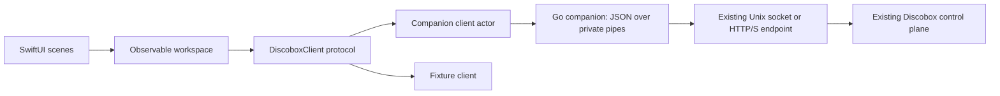

# Discobox for macOS

## Purpose

A native client of the existing Discobox control plane. Boxes belong to the
backend, regardless of whether the CLI, GUI, or another client created them.
Closing the app never shuts down a box or the server. The app stores connection
and presentation preferences only, not a second database of boxes.

## Safety boundary

Development and automated verification must not contact the operator's running
Discobox. Use fixtures and injected transports. Never run `discobox` implicitly:
the CLI can autolaunch the server, deliver source, or revive a primary terminal.

Normal launch attempts the default local endpoint once. Demo and smoke modes stay
offline. A connecting screen covers the initial project/list reads; failure or
cancellation returns to the manual connection form. Connecting reads existing resources. Selecting a
live terminal opens an interactive stream, resizes it, and holds activity while
attached. Stopped/cached terminals use the observational screen endpoint.
Lifecycle, file-write, and approval mutations require explicit UI actions; the
companion validates an allowlist and requires per-request management permission.
No server shutdown operation is exposed. The explicit New Shell operation creates and starts only a newly returned shell ID;
it is never called by selection or polling.
Before every attach the helper verifies running box and terminal state. Both
virtual primary and concrete ended terminals can be revived by the backend's
attach handler; the client refuses these states, but cannot make its checks
atomic with the backend attach. Development checks use only local fixtures.

## Swift conventions

- Swift Package Manager, Swift 6 strict concurrency, macOS 14 minimum.
- SwiftUI scenes, NavigationSplitView, system toolbar, inspector, Settings,
  semantic colors, keyboard shortcuts, accessibility labels, and native text.
- A small `@MainActor @Observable` workspace model owns presentation state.
  Views describe that state; they do not launch processes or construct API URLs.
- A `Sendable` client protocol separates UI from transport. Actors isolate
  transport; structured tasks handle polling and cancellation. Stale replies
  cannot replace the state of a newly selected server, project, or box.
- Codable DTOs model the subset of the canonical OpenAPI contract we consume.
  Unknown enum strings survive decoding; missing observations stay unknown.
- The client resolves `GET /projects/default` at connection time, retaining the
  returned concrete project ID. Projects are not selectable or shown in the UI.
  Failure to resolve the default is a connection error, never a fallback to a
  different project.
- AppKit's NSViewRepresentable hosts Ghostty's Metal surface. NSTextInputClient
  handles composed text; Ghostty encodes keys and terminal mouse input.
- A main-actor observable session store owns surfaces by connection/project/box/exec
  identity. SwiftUI view replacement never owns or destroys the remote process.
- Swift Testing covers wire shapes, state interpretation, stale responses,
  and request policy. Go tests cover the companion's boundary independently.

## Components

The companion is an ordinary unprivileged child process, with no backend launch, database access, or service installation. Explicit repository
delivery temporarily runs a loopback HTTP proxy restricted to Git routes for the
newly created box. A request and response
use JSON through stdin/stdout. Each bounded request gets one process; cancellation
terminates that child only. This favors a small, inspectable first integration.
If profiling warrants a persistent companion, retain request IDs and cancellation
in a versioned protocol rather than adding ad hoc output parsing.

It resolves the default Unix socket the same way as `pkg/endpoint/default_unix.go`:
`XDG_RUNTIME_DIR`, otherwise the OS temporary directory plus `discobox-<uid>`,
then `discobox/server.sock`. It never changes backend configuration to expose TCP.
HTTP/S is supported when the existing server already exposes it. TLS validation
stays enabled. Redirects are rejected. Current single-user auth is supported;
Iroh enrollment and Discobot assertions are not implemented in this build.

Reads are an allowlist of operations, not an arbitrary HTTP proxy. The bounded
legacy input operation still requires an explicit flag. The GUI now uses a
separate `--attach` mode for live terminal input and output.

## Terminal strategy

Ghostty v1.2.3 is pinned as a locally built static XCFramework. The app packages
its resources and license; no standalone Ghostty installation is needed. The
embedding C ABI is internal, so upgrades require rebuilding and testing both SDK
and app. Workspace-local SDK/archiver shims handle current Xcode compatibility.

Each Ghostty surface owns a local PTY child running the bundled Go helper. Every
command argument is shell-quoted. The helper uses the existing Unix or HTTP/S
transport, framed WebSocket protocol, and `pkg/execstream/resume`; terminal bytes
never enter SwiftUI observation state. The helper puts its PTY in raw mode,
forwards SIGWINCH as resize frames, and handles local HUP/TERM by detaching,
not by forwarding those signals. Typed Ctrl-C remains remote terminal input.

Session identities include a connection UUID, endpoint, project, box, and concrete
exec ID. Switching tabs/boxes retains the surface and local stream; disconnect
and app exit free all surfaces. Remote exit leaves its output visible, with a
Reconnect action. Cached/stopped sessions retain the read-only saved-screen view.
Live sessions no longer poll screen endpoints. Metadata polling remains bounded.

Reconnections reuse acknowledged action positions, replay and retained dimensions.
Live-state checks fail closed, ending retries when the server cannot establish
that the terminal remains live. There is no lifecycle or CLI invocation.

`--demo` runs a synthetic local PTY child. `--terminal-smoke` uses that child to
check output, Unicode, AppKit key input, text insertion, resize, alternate screen,
exit, and teardown without reading saved endpoints. Go fixtures exercise the
actual WebSocket/resume boundary and assert detach sends no signal/close-input.

## Evolution

1. Extend terminal testing across keyboard layouts, input methods, and supported
   macOS versions; add keybinding settings, audit, and filesystem workflows.
2. Reuse `pkg/endpoint` for Iroh and address discovery, using the enrolled client
   identity without creating or modifying enrollment implicitly.
3. Expose existing CLI creation, source delivery, apply, and forwarding workflows
   through structured operations. Those are client responsibilities, not simple
   REST calls. CLI-internal packages require a deliberate extraction or a
   companion entrypoint within the CLI module; do not duplicate their Git logic.
4. Add native approval decisions and lifecycle controls with explicit intent,
   observed-state progress, and appropriate confirmation for destructive actions.
5. Add capability/protocol discovery and server events when their backend
   contracts exist. Until then poll with cancellation and show stale data.

Do not convert a prototype estimate into a claim of full CLI parity. The initial
delivery is an existing-box workspace; creation, apply, approvals, forwarding,
file transfers, and signed distribution remain separate milestones.

## Command routing and settings

`CommandBindings` and `LeaderRouter` hold the serializable, UI-independent policy.
`WorkspaceCommands` installs one local AppKit event monitor scoped to the workspace
window. It declines editable text fields, sheets, and other windows; suppresses
both halves of consumed key events; expires prefixes; and routes unbound ordinary
keys through to Ghostty. Double-leader sends a literal control byte directly to
the focused terminal. Command actions are shared by menus, buttons, and bindings.
Validated preferences persist in UserDefaults; invalid stored data falls back to
defaults. The settings draft is separate from active bindings until Save.

New Shell uses a distinct companion flag, checks running state, creates a shell
with the server's default shell/workdir, starts only its returned ID, and fetches
its record. Ambiguous failures are never retried automatically. Selection revision
checks prevent late responses from changing a different box's current terminal.

New Box and Close Shell use a separate management authorization flag. Creation
reuses sandboxcreate for origin, source pinning, and delivery, then returns the
new record; it does not start/stop an existing box, invoke the CLI, or sync SSH
configuration. Long requests are cancelled on application termination; source
failure leaves the created box available for inspection rather than deleting it.
Close Terminal checks the concrete exec's live record and refuses primary,
cached, and non-TTY targets before DELETE. The older shell-only operation also
refuses harness sessions. This is a destructive shell action,
so the GUI confirms it explicitly.

The native Audit tab uses bounded parallel snapshots of the five default trails.
Records are keyed by trail/pool/ID/event, merged, and sorted by parsed time.
Unavailable sources and bounded-history warnings are part of the response, not
silently dropped. History uses per-trail inclusive time bounds; HTTP following
uses per-pool row cursors. Timestamp-only ties are reported as a limitation.
Body previews are explicit bounded reads, never included in background polling.

Approval snapshots are project-wide and independently polled every two seconds.
Connection/request generations reject stale reads. Answers re-read the specific
pending record then perform one authenticated backend mutation without retry.
Policy JSON preserves resolved variables and unknown fields. Secret values are
write-only UI state, sent through stdin and never logged or persisted by the GUI.

FileAccess captures client/project/box for a transfer's whole lifetime. The Go
helper streams HTTP bodies from/to files, reporting byte counts over stderr and
cancelling via context on SIGTERM. Downloads stage privately and publish using
Darwin's exclusive rename; uploads use ifExists/ifVersion. Recursive traversal
refuses symlinks, invalid names and excessive depth. Folder transfers are bounded
in concurrency, but not atomic as a tree.

Tool launches read the authoritative sandbox catalog, refuse host declarations,
reuse running sessions by metadata, and create/start only the newly returned ID.
The primary harness is never deleted. Review state remains in the box repository.

## Native box management

`BoxAction` defines the desktop's lifecycle actions and state-dependent availability.
A confirmation captures the box ID and connection generation. Workspace rejects
stale connections and duplicate in-flight actions without retargeting the request.
The companion accepts only start, stop, archive (DELETE), unarchive, upgrade, repair,
purge, and rename (PATCH meta); it never retries mutations. Purge additionally reads
the current box and rejects non-archived state. The backend owns final concurrency
and lifecycle validation. Successful disruptive actions clear the selected box to
avoid retaining an attachment while the requested transition settles.

Sidebar presentation reads harnessConfig, source URL, displayState and cached
agentStatus from the existing list response. It makes no live inspection requests
to obtain labels. Repository grouping is a local presentation preference.

## Service forwarding

The service declaration endpoint describes repository scripts; it is not the
complete port list. `--forward` polls the selected box's recorded agentStatus.ports
and uses the CLI's internal portforward library for loopback TCP/UDP listeners,
collision handling and connection teardown. A client-side adapter mirrors the
CLI's framed WebSocket tunnel contract, including half-close and UDP datagrams.
Read-only box queries gate forwarding and each tunnel connection on running state.
No backend files or endpoints are changed. The unavoidable check/attach race is
the same as terminal attach; backend validation remains authoritative.

The companion streams bounded JSON snapshots to a retained Swift process session.
HTTP/HTTPS links use the reported local binding, never the sandbox's port number
by assumption. A parent's stdin EOF or termination cancels all listeners. Swift
closes sessions on disconnect, lifecycle actions and stopped/removed boxes; hiding
the Services drawer does not break already-open browser tabs.

## Embedded WebKit desktop

One retained NSWindow/WKWebView session per box opens only on explicit Open
Desktop. It loads a loopback-only companion proxy of the existing desktop port.
The proxy preserves the viewer and APIs, appending a clipboard adapter only to
app.js. This depends on the current viewer's state.rfb/state.connected seam and
fails visibly if it is unavailable; it is not a new backend API contract.

WKWebView uses a nonpersistent data store. Navigation stays on the viewer origin;
explicit external HTTP/S links open externally. Native messages must come from
the main frame at the expected origin. Remote clipboard text is bounded to 1 MiB;
local clipboard reads happen only through native paste actions. Commands send
Ctrl-C/V, or Ctrl-Shift-C/V in terminal mode, through noVNC's public APIs. No
JavaScript string interpolation is used for clipboard content.

Lifecycle actions, disconnect, box disappearance and app exit close viewer
windows; a manual window close only terminates its local proxy and viewer.
The proxy terminates on parent stdin EOF, including unexpected app termination.

Terminal surfaces have stable identity, guarded deferred focus, and explicit
layout/redraw after remount. This keeps cached Ghostty surfaces at their final
container dimensions when cycling boxes with the leader and brackets.

### Workspace tabs

WorkspaceTabs owns selection, open utility tabs, split orientation, agent pinning,
and pane focus for each connection/box. WorkspaceCommands retains these models
while switching boxes and clears them on connection changes. The tab strip uses
existing terminal inventory plus explicitly opened Audit/Services/Files tabs.
All tool content uses one selected pane, optionally sharing an NSSplitView with
the pinned harness; no independent left activity drawer is created. TerminalStore
retains the Ghostty sessions while their tabs are hidden. Closing a terminal still
uses the existing confirmation and explicit backend close action.

Command-Shift-brackets navigate tabs; Command-brackets cycle the two panes.
These commands are scoped to the workspace window, excluded while a sheet is
active, and exposed in the native Workspace menu. Tool focus relinquishes the
terminal responder without stealing focus from an already-clicked text field.
