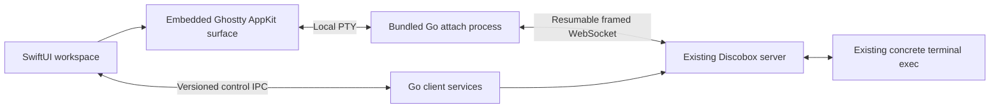

# Implementation plan

## Next iteration: a live native workspace

Requested scope: embedded Ghostty, default-project-only navigation, box audit,
direct terminal input, editable keybindings, and drag-and-drop remote files.
This section supersedes the first build's screen-console design. It is a plan,
not a claim that these changes have been implemented.

Incremental status: native terminals, default-project navigation, configurable
bindings, shell lifecycle, box creation with a prompt, automatic approvals,
review/tools, additional agent sessions, streamed files, and audit history/body
previews are implemented. This iteration still needs UI/manual validation against
real workflows; development uses fixtures only. Backend changes are out of scope: inbox updates use polling and no new owner override is implemented. Remaining
protocol/product limits: timestamp-only audit ties,
OAuth sign-in/local refresh-command workflows, and host-tool launching.

### 1. Prove Ghostty embedding and the real attach path first

Embed Ghostty inside the workspace. Do not launch the standalone Ghostty app or
embed the Discobox TUI. Use an AppKit surface behind NSViewRepresentable, with
SwiftUI owning window chrome, tabs, and layout.

The upstream distinction matters: the public libghostty-vt library is a terminal
engine, not the complete native rendering view. The full macOS surface API in
include/ghostty.h is explicitly internal and not designed for external use.
Prototype a pinned build of that full surface, isolate it in a GhosttyTerminal
target, and document the exact revision, Zig/toolchain requirements, license,
resource bundle, and binary packaging. Do not treat the installed Ghostty.app as
a supported SDK or depend on moving main. This carries an ongoing compatibility
cost; the alternative is implementing a renderer over public libghostty-vt,
which is substantially more work and is not the initial recommendation.

Proposed data path:

Use Ghostty's child-process/PTY path initially rather than assuming a supported
API for injecting arbitrary output into its renderer. Its child is a fixed,
bundled attach executable, not a user shell. The helper puts its PTY in raw mode,
forwards bytes, and translates SIGWINCH into remote resize frames. Resolve
session identity through structured configuration; do not interpolate prompts,
paths, or secrets into shell command strings. Keep diagnostics off terminal data.

Reuse Discobox's pkg/execstream/resume and transport code for readiness, replay,
acknowledgements, bounded pending input, reconnect, and exit detection. Inspect
pkg/execstream/client for reusable raw-terminal/session handling. Use a companion
process per attached terminal plus a persistent, cancellable control channel for
subscriptions and transfers. UI stores do not receive every terminal byte.

Acceptance gate before building around the dependency:

- A packaged app renders a synthetic VT stream with color, alternate screen,
  Unicode, selection, scrollback, paste, keyboard input, and resize.
- An isolated framed host proves end-to-end attach and reconnect without lost or
  duplicated input, including a lost acknowledgement and a dead remote process.
- Focus, IME composition, Retina changes, sleep/wake, high output volume, and
  surface teardown work without freezing the app or leaking a helper.
- Build/signing is reproducible and not dependent on a developer's Ghostty install.

Dependency downloads were unavailable during the first build. Recheck that early;
do not silently substitute the old screen viewer and call the spike complete.

### 2. Default project and session ownership

Resolve the server's default project and retain its concrete ID internally. Use
the existing default alias where appropriate; do not hardcode a database ID or
fall back to an unrelated first project when resolution fails. Remove the project
picker, project sidebar section, and project detail from the inspector. The
sidebar presents boxes and filters. Server connection settings remain.

Add a session store keyed by server, resolved project, box, and concrete exec ID,
separate from list refresh and SwiftUI view identity. A view re-render must not
recreate a terminal. Preserve terminal selection and scrollback across box changes.

Selecting a running box's terminal attaches and accepts typing immediately: no
checkbox, composer, Send button, or key menu. Stopped/archived boxes show a status
placeholder, not an automatic start. Avoid the virtual primary exec ID, which can
revive a process. Ghostty gets terminal focus when appropriate, never while the
person is editing a search field or recording a shortcut.

Attach is an active backend operation and can keep a box alive. Default to
detaching hidden box sessions while retaining their local view state; reconnect
and repaint on return. Do not let restoring a window attach to every remembered
box. A terminal tab close disconnects that client, not the remote exec. Multiple
clients share the remote terminal's size; resize only from the active surface.

"New Shell" is an explicit action on the current running box. Reuse the existing
create/attach/start ordering in tui_terminal.go, returning the concrete exec ID.
Never guess the sandbox's shell from the Mac's login shell. Cleanup must apply
only to a newly created session that was never successfully handed to the UI;
do not terminate an existing terminal on disconnect or ambiguous failure.

### 3. One command model and editable keybindings

Create an AppCommand registry with stable IDs, labels, scopes, default shortcuts,
and availability. Menus, toolbar buttons, keyboard handling, and Settings invoke
the same command dispatcher. Keep it independent of Ghostty's binding format.

Initial commands: next/previous box, choose box 1–9, quick box switcher, new shell,
next/previous terminal, focus terminal, show audit, toggle files, refresh, and
detach current terminal. Suggested defaults favor Command-based shortcuts so
Ctrl-C, Ctrl-D, Ctrl-A, and other terminal controls retain their normal meaning.

Settings > Keybindings provides searchable actions, a native shortcut recorder,
conflict/reserved-key feedback, clear binding, reset action, and restore defaults.
Persist versioned Codable overrides in app preferences. Update menu shortcut
labels immediately; do not require a relaunch.

Support optional two-stroke bindings, including Ctrl-A followed by Shift-A for
Show Audit. The prefix has an explicit timeout/cancel/passthrough policy so an
unmatched chord does not silently eat shell input. A Discobox-compatible preset
can enable the leader; the default should leave Ctrl-A available in the terminal.

Route focused-window app commands before Ghostty; otherwise Ghostty handles the
event and encodes terminal input. Honor native text editing and IME, and do not
install a system-wide key monitor. Recording a shortcut must never send it to the
remote terminal. Verify keyboard layouts, repeats, Command-C/V, and chord failures.

### 4. Audit panel matching the existing console

Add an Audit workspace tab/pane and Show Audit command. The Ctrl-A, Shift-A console
view follows five sources by default: HTTP, credential verdicts, secret refreshes,
harness hooks, and exec events. DNS is separately available, not one of those five.

It is a merged, polled timeline, not one backend WebSocket stream. Follow the
existing auditTimelineTrails/readAudit behavior: per-source and per-pool cursors,
time lookback where no ordered cursor exists, deduplication, bounded history,
initial backlog, and explicit reports of unavailable trails. A single timestamp
cursor across sources is incorrect because clocks differ.

Move the reusable collector out of CLI presentation code into an appropriate Go
client package, or expose it through a companion entrypoint in the CLI module.
Do not parse printed terminal tables or copy a second merger into Swift. Keep
server/runtime behavior unchanged; any source refactor needs the relevant repo
design/review rules and tests.

Deliver typed audit updates over control IPC. SwiftUI owns filtering, search,
follow/pause, preserved row selection, and a detail inspector. HTTP bodies load
only when opened, with size caps and an explicit download for larger content.
Cancel a subscription on box change; distinguish "no events" from "source offline".

### 5. Files pane and native drag-and-drop

Add a collapsible Files pane beside the terminal: breadcrumbs, back/up navigation,
directory rows, size/type/modified columns, refresh, and transfer progress. Start
at the box's reported working/source directory, not a hardcoded /workspace path.
List directories lazily; do not recursively scan the box on selection.

Use the files API for stat/list/content/mkdir and its atomic per-file writes.
This is not sandbox export/import: those routes move whole boxes between servers
and have different lifecycle requirements.

Drag in from Finder or another app:

- Accept file URLs and promised files, multiple selections, then directories.
- Show the actual destination. Stream bytes through a dedicated transfer path;
  no base64 JSON payloads, whole-file memory buffers, or shell cat commands.
- Default to create-only writes. On a collision offer Replace, Keep Both, or Skip.
  Use ifVersion for deliberate replacement and handle 412 as a concurrent edit.
- Support byte progress, cancellation, bounded concurrency, and per-file failures.
  Directory transfers are a series of atomic files, not an atomic tree transaction.

Drag out to Finder or a compatible app:

- Use NSFilePromiseProvider so the remote file is materialized at the destination
  after the drop. Support NSItemProvider file representations where needed.
- Stream into a partial local file and rename after successful completion. Never
  claim a transfer completed before the bytes have arrived.
- Keep explicit Download/Upload commands for keyboard access and apps that do not
  support promises. Dropping onto the terminal uploads first, then inserts the
  correctly quoted remote path; it must not execute a command automatically.

Define symlink behavior rather than silently traversing links during recursive
copies. Validate remote names against path traversal when creating local files,
never overwrite through a local symlink, and surface unsupported file kinds.
Don't assume resumed offsets imply a stable file: compare versions before/after
download and refuse to combine bytes from different revisions. No automatic
upload retry when the result of the previous write is unknown.

The current companion has a 15-second timeout and an 8-MiB JSON response cap;
neither is suitable for files. Add transfer-specific streaming, progress, and
cancellation without removing the limits on ordinary metadata requests.

### 6. Non-interference and verification

Keep the existing operator's server and boxes untouched while implementing and
testing. Use fixtures, synthetic PTYs, framed-stream test hosts, and isolated
temporary transfer directories. Do not start/stop/delete boxes for verification.

File reads, attaches, shell creation, and input are active operations in Discobox
and can wake a stopped box. A client-side running-state check has a race: it cannot
provide an atomic "never wake" guarantee. No background file reads on selection
or restoration; open the Files pane only for an explicitly selected running box.
If a strict no-wake guarantee is required for operations during a concurrent stop,
propose a backend no-start precondition rather than claiming the UI can ensure it.
This does not authorize experimenting on the user's running server.

Test shortcut dispatch while Ghostty has focus; audits with skewed timestamps and
missing sources; large binary transfers, collisions, cancellation, symlinks and
destination-box changes; and default-project resolution. Add demo audit/files
fixtures so the complete workspace remains reviewable without a server.

### Delivery order and completion criteria

1. Ghostty/PTY/attach spike and pinned packaging: prove the highest-risk dependency.
2. Default-project cleanup, session store, live terminal, and explicit New Shell.
   Remove the checkbox/composer and screen polling from live terminals here.
3. Command dispatcher and keybinding settings, including optional leader chords.
4. Audit collector and native timeline, wired to that dispatcher.
5. Files browser, single-file drag in/out, then directory transfers and conflict UI.
6. Integrated focus/reconnect/transfer checks and a packaged demo build.

Each delivery has its own tests and working app. Completion means the GUI can
type into an existing agent terminal, switch boxes, open a shell, inspect the same
audit timeline as the console, and exchange files with Finder using configurable
shortcuts, while CLI access continues independently. Source review alone does not
count as validation of the Ghostty integration or live attach behavior.

References:

- [Ghostty internal surface API](https://github.com/ghostty-org/ghostty/blob/main/include/ghostty.h)
- [Upstream discussion of output-only embedding](https://github.com/ghostty-org/ghostty/discussions/12131)
- [Apple file promises](https://developer.apple.com/documentation/appkit/nsfilepromiseprovider)
- `discobox/cli/internal/cli/tui_audit.go`, `audit_list.go`, `audit_follow.go`
- `discobox/cli/internal/cli/tui_terminal.go`, `sandbox_files.go`
- `discobox/api/openapi/server.yaml`, `discobox/pkg/execstream/resume/DESIGN.md`

## First build: implementation history

1. Record the independent-client architecture and non-interference boundary.
2. Build typed models from the checked-in OpenAPI contract for projects, boxes,
   execs, services, and terminal screens; preserve cached/unknown state.
3. Build a narrowly scoped Go companion for existing Unix socket and HTTP/S
   endpoints. No backend dependency changes or CLI execution.
4. Build the Swift client actor, cancellable process transport, fixture client,
   and observable workspace with race-safe refresh and selection behavior.
5. Build the native workspace: connection welcome screen, project sidebar,
   searchable box list, console/services tabs, inspector, and Settings.
6. Implement explicit input opt-in and text/key submission to concrete live
   terminals. Default viewing must never revive, resize, or keep a box alive.
7. Test using fixtures and injected transports only. Compile the macOS app and
   package a local `.app`; do not launch it against the operator's server.
8. Document build/run instructions, verified behavior, and remaining milestones.

The first build intentionally uses the backend-rendered screen API. Streaming
SwiftTerm integration and the remaining full-client milestones are specified in
ARCHITECTURE.md, not represented as implemented features.

## Delivery status

Ghostty SDK spike (2026-10-26): the pinned v1.2.3 native arm64 XCFramework
builds with Zig 0.14.1 and the GUI-installed Metal toolchain. Workspace-local
SDK and archiver shims accommodate the current Xcode without changing installed
tools. A linked version-only probe reports `Ghostty 1.2.3`; cached rebuilds pass.
The desktop now embeds the surface and streams through a bundled Go helper
using the existing resumable protocol. The session store retains surfaces across
box/tab switches. Direct keyboard input replaces the checkbox/composer, and live
screen polling is disabled. Local PTY smoke checks and WebSocket fixtures cover
input, Unicode, resize, alternate screen, reconnect, refusal of stopped/cached
terminals, and detach. No running Discobox instance was accessed by these checks.
Audit, tools, additional agent terminals, and file transfers remain later work.

Steps 1–8 are implemented for the first-build scope above. The local artifact is
`dist/Discobox.app` (ad-hoc signed). Verification on 2026-10-26:

- Swift debug compilation and 11 Swift Testing tests passed.
- Go's 8 top-level tests passed with race detection; `go vet` passed.
- Swift release compilation and app packaging passed.
- The app bundle's signature and Info.plist validated.
- No live-backend test or visual runtime inspection was performed.
- `git -C discobox status --short` remained empty; no backend source was edited.

Tests include late connection/screen replies, cancelled companion processes,
authorization errors, cached terminals, input opt-in, and rejection of lifecycle
routes. Release packaging omits debug symbols because this environment denied
dsymutil's cache access; debug/test builds retain their normal symbols.

## Command settings and workspace UX — 2026-10-26

Implemented: a window-scoped AppKit event monitor routes a configurable leader
before Ghostty. The Foundation-only router has tests for cancellation, literal
leader forwarding, custom sequences, and prefix collisions. Settings persists
validated bindings; the Workspace menu and command sheet use the same dispatcher.
Default suffixes follow CLI equivalents where implemented; GUI additions and
semantic differences are listed in README. Audit/tools/lifecycle shortcuts are
explicitly unavailable, not forwarded to a shell. New Shell is an explicit,
separately authorized companion operation on a running box, tested with fixtures.

The screenshot exposed redundant hierarchy: a filter sidebar, box sidebar, large
box heading, workspace picker, and terminal picker before any working content.
The first design pass now uses one box sidebar with search/filter, the selected
box name in the window toolbar, and one horizontal terminal strip with an Open
Shell button and Services. Inspector is closed by default. Rows use a status dot,
name, and one secondary line instead of repeating large icons and platform labels.
Focus mode hides the sidebar. A transient leader hint appears only during a chord.

Next UX slices, in order:

1. Native audit as a workspace tab beside Services. Preserve its filters and
   scroll position per box. Ctrl-A, Shift-A opens this view once implemented.
2. Tools as a searchable command panel, with explicit launch actions and tabs
   for running tools. Do not put unsupported commands into the active key map.
3. Files as an optional right-hand browser with a workspace-relative breadcrumb;
   drag from Finder to upload and drag to Finder to download. Keep transfer
   progress in a small tray, with overwrite decisions next to the affected file.
4. Shortcuts recorded by pressing keys as an alternative to sequence text fields;
   retain readable multi-key sequences and conflict checks.
5. Refine terminal typography/theme alongside the app chrome after visual testing
   in both appearances; preserve terminal contrast and selectable text.

Verification uses the offline demo only. The command smoke check posts real
AppKit events to verify remapping, multi-key Services, text-field isolation,
agent selection, demo shell selection, and cancellation. No operator backend is
used. Audit, tools, and drag/drop remain separate implementation work.

## Workspace controls and audit delivery — 2026-10-26

Implemented the requested control placement and behavior: Settings-only keyboard
configuration, ⌘H command help, reconnect beside the bottom-right status, and
trackpad pull-to-refresh on the box list. Shell × confirms termination of only a
non-harness TTY exec. New Box asks for a configured harness and optional remote
repository; the companion reuses CLI-internal sandboxcreate code through a local
module dependency, without editing or invoking the CLI or syncing SSH config.
The module import path is under the CLI namespace solely to access that shared
internal package; it is still built and packaged from this checkout.

Audit is available as a workspace tab and leader A, with filtering, search,
Follow, and JSON details. Five default trails are polled in parallel, with
pool/source failures shown. This delivery deliberately labels its limits:
1,000 recent rows per trail/poll, 5,000 retained, 16 KiB detail, bounded transport.
It does not yet implement historical pagination, the CLI's full incremental
per-pool cursor follower, HTTP body downloads, or grouping. High-volume intervals
can have gaps; those limits are visible rather than claimed as full parity.

Validation includes mock create requests with fixture host identity, protected
agent/cached-exec close rejection, the exact shell DELETE path, five audit trails
and unavailable pools, demo creation/closure/reconnect, and AppKit tests of Audit,
⌘H, the new-box sheet, and shell closure. No running operator instance is used.

## 2026-10-26 client implementation pass

Implemented: automatic approval inbox and red ! marks, approve/deny with duration
and preserved policy, trust pins, entered token refresh, token creation, explicit
repository/every-box auto-approval rule and credential-restriction review; optional
creation prompt; sandbox tools and Changes via discobox-review; extra harness
sessions; files with streaming upload/download and native drag representations;
audit paging, per-pool HTTP forward cursors, body previews and exact binary export;
NSSplitView divider persistence. Tests remain offline and the backend checkout
and operator configuration are unchanged.

Out of scope by user instruction: backend event push and a new owner-override API.
The UI polls the existing inbox automatically.
The implementation does not silently disable judging. OAuth sign-in and executing
local refresh commands remain CLI flows; host-tool launching is not supported.
Audit timestamp ties can reach the existing API's page limit, which the UI reports.
Directory uploads stop at the first failure and may leave completed files.

Validation: 22 Swift tests, Go race/vet, app signing, and fixture panel rendering
passed. The Mac reports its session locked; keyboard-event smoke cannot obtain a
key window and PTY smoke cannot create a Ghostty surface in that state. Those
interactive checks are blocked, not passed. Finder drag/drop has not been manually
exercised. No operator server was used for testing.

## Native lifecycle and sidebar follow-up

Implemented repository grouping, searchable harness/repository/branch labels,
authoritative displayState, per-box context actions, toolbar actions, native
trailing swipe Archive/Purge and leading swipe Restore. Lifecycle confirmations
include exact target and consequences, with typed DELETE for permanent purge.
Start/stop/archive/restore/upgrade/repair/rename use existing backend endpoints.
Tests use injected HTTP transports and demo state only. Physical trackpad swipe
interaction still needs a manual check on the operator's Mac.

## Services correction

Replaced the declarations-only panel with Desktop and reported TCP/UDP ports,
plus repository service process states. Web links use loopback bindings from the
same forwarding library as the TUI, including remapped local ports. Non-web ports
are copyable addresses. Forward sessions survive hiding the drawer and are closed
on disconnect, stop/removal, rebuild actions or app exit. No backend changes.

Validation: 29 Swift tests and Go race/vet passed. Fake-server tests exercise
browser traffic through a WebSocket tunnel, port collisions, TCP half-close, UDP
framing and parent-EOF listener teardown. Offline sidebar/panel rendering passed;
native material rendering in cached NSView images is incomplete, so those captures
verify layout rather than final colors. No live Discobox was contacted.

## WebKit desktop, clipboard, and box-switch redraw

Implemented an app-owned desktop window using WebKit and the existing viewer.
A local companion proxy preserves annotations/resize and appends a clipboard
adapter; no backend changes. Native text Copy/Paste and Command-C/V are bridged,
with a terminal-mode Ctrl-Shift-C/V option and optional remote clipboard sync.
Browser fallback, reconnect, and full-screen controls remain available. The
underlying VNC server's encoding support still applies; images/files are not
handled by the text clipboard bridge.

Retained Ghostty views now use stable representable identity, guarded deferred
focus, and explicit layout/redraw after remount. The offline keyboard smoke
passed repeated box changes, retained surface identity and final pixel sizes.
29 Swift tests and Go race/vet passed. The WebKit fixture smoke passed loading,
Command-V, multiline/Unicode arguments to noVNC, terminal modifiers, and remote
copy into a private pasteboard with automatic synchronization disabled. These
verify the client bridge, not a live x11vnc server's clipboard encoding.

Remote connectivity was investigated, not implemented: backend Iroh supports
peer enrollment; GUI Iroh/auth UX remains future work. Externally managed SSH
forwarding of the server's Unix socket can use the current GUI endpoint support.

Credential notification layout regression: the inline attention banner removed
40 points (three rows in the offline fixture) from the harness when a request
arrived. Review now lives in the fixed harness header; the footer has a fixed
height and displays leader hints inline. The native command smoke reproduced
the geometry change before the header fix and now passes repeated approval/hint
arrival and removal without changing terminal bounds or rows/columns. Existing
split, box switching, and approval sheet checks also pass. Release app rebuilt.
No live backend actions were used.

Modified Enter parity: embedded terminals now match Discobox's paneKeymap:
Shift-Enter sends ESC CR; Ctrl-Enter sends LF through Ghostty raw text actions,
not clipboard-style insertion. Unmodified Enter and IME composition retain their
existing path. The offline PTY smoke verifies received control sequences and
passes existing input, resize, alternate-screen and teardown checks. App rebuilt.

Workspace tabs implemented: one strip for Agent, terminal sessions, Audit,
Services and Files. Keep Agent Visible defaults to a stacked native split; the
Layout menu and tab context menus offer side-by-side or single-tab views.
Command-Shift-brackets switch tabs and Command-brackets move pane focus.
Selection/layout survives box changes within the connection. Existing terminal
close confirmation remains in place. Stable split containers avoid losing a
retained Ghostty view when maximizing a tab.

Validation: 29 Swift tests and Go race/vet passed. Updated native command smoke
passed tab order, pane responder focus, terminal identity across tab/box changes,
stacked/side-by-side/single layouts, approvals, files, sheets and shell closure.
Release app rebuilt; offline layout snapshots inspected. Backend unchanged and
no running boxes accessed by development tests.

Audit and app shortcuts refinement: Audit focuses Search on entry/pane focus;
its event-detail divider initializes to two-thirds list / one-third detail, once
per insertion, using NSSplitView.arrangedSubviews (excluding decoration views).
Pinned-agent tab cycling excludes Agent. App shortcuts now have a separate
persisted, validated settings section and dynamic menu equivalents: Cmd-N new
box, Cmd-K box switcher, Cmd-Shift-brackets tabs, Cmd-brackets panes, Cmd-H help.
Empty bindings disable an action; duplicates and reserved editing shortcuts
are rejected. Leader configuration stays separate.

Box inventory observers reject stale snapshots; implicit default exec selection
does not reset remembered tabs. Terminal focus is restored on mounting, and
deferred focus requests check that their pane still wants focus.
Validation: 31 Swift tests plus Go race/vet passed. Native offline command smoke
passed Audit search focus, the native one-third split component and user-divider
preservation, pinned tool-tab wrap, Cmd-N/Cmd-K, custom shortcut dispatch, tab
and pane focus, box restoration, approvals and existing terminal checks. Release
app rebuilt. Backend and running instances were not changed.

Pane-local headers: removed workspace-wide tab strip and repeated selected-tool
label. Pinned Agent has one header; tool tabs live in the other pane's header.
Default is side-by-side with Agent leftmost. The Agent command focuses its pane
without hiding tool tabs. Unpinned single-tab mode also uses only one header.
Native command smoke passed, including lowercase Command-N/K, remapping, Audit,
tab/pane focus and layout transitions; offline preview inspected. App rebuilt.
The reported missing shortcuts were traced to a GUI process launched at 10:18,
before their implementation; no saved app-shortcut override was present.

Approval presentation simplified: a single pending request opens the approval
form directly in the original sheet. Multiple requests retain a chooser; choosing
one replaces its content instead of stacking a second sheet. Actions are Later
on the left, Approve and Deny on the right. Approve submits directly; Deny is
the Return/default action and Later is Escape. Existing validation, stale-request
and connection checks remain. The native offline smoke entered via the inbox,
pressed Return in the real sheet, and verified the fixture received deny, with
no intermediate review. Full native smoke passed; app rebuilt. No live pending
request was read or answered by the test.

Box switcher and branding: native field-editor delegate handles Up/Down, Return
and Escape without leaving search. First result is selected; empty results cannot
submit. Sidebar and switcher share case-insensitive, multi-term matching across
name, ID, harness/model, repository, branch and metadata. Running app explicitly
loads the bundled Discobox.icns into NSApplication.applicationIconImage to avoid
relying only on Launch Services' cached icon; source mascot asset verified.

Terminal overlap mitigation: resize notifications coalesce onto the next main
queue turn and detached views do not change Ghostty/PTY geometry. Initial PTY
Resize precedes Ready/replay on attach. Offline tests verify that ordering and
that detaching and assigning a 1x1 frame leaves the terminal grid unchanged.
No claim of reproducing the exact live Codex screen; no running box accessed.
Validation: 32 Swift tests, Go race/vet, native command smoke including keyboard
box selection and combined harness/repository search, and terminal smoke all
passed. App rebuilt. Backend unchanged.

Visual refinement: local terminal defaults now use a cool charcoal background,
soft lavender foreground and a coordinated ANSI palette inspired by the user's
TUI screenshot. These are local output OSCs emitted by the companion, never
remote input; application-specific true-color output remains authoritative.
Discobox's TUI source confirms it inherits the host terminal background rather
than defining one fixed background palette. Native controls/focus use a softer
brand purple, with subtle filled/outlined selected tool tabs. Updated offline
command smoke passed and the palette snapshot was inspected. App rebuilt.

## Iroh remote connections — implemented

- App-owned Keychain identity; manual server enrollment using a copyable public ID
  and command. No backend changes or automatic listener configuration.
- Saved connection names, addresses and relay settings; one active host. Default
  startup remains local. Remote transport sockets are separate from display URLs.
- Persistent Go helper reusing `pkg/endpoint`, ephemeral certified transport keys,
  private Unix HTTP/WebSocket proxy, stdin lifetime and owner-only permissions.
- Existing terminal, service, desktop, file and source-delivery helpers use the
  private socket. Normal reconnect preserves the transport; disconnect closes it.
- Custom relays and direct-only mode with explicit address hints.
- Native library bundled and ad-hoc signed; upstream licensing README included.
- Offline tests cover shared helper lifetime, workspace separation, real Iroh
  authentication, HTTP, WebSockets, revocation and cleanup. The same transport
  fixture can exercise the packaged helper using DISCOBOX_TEST_IROH_HELPER.

Remaining validation: a two-host enrollment and NAT/relay test on a designated
remote test server. Existing user instances are not used by automated tests.

Validation for this implementation: 39 Swift tests, Go race tests/vet, and the
packaged-helper Iroh fixtures pass. Bundle signature verification passes. The
broader offline GUI command smoke did not complete: inspector/maximize timing
and native key-window acquisition failed in separate runs. No layout code was
changed to work around those failures. Two-host relay/NAT validation remains.
