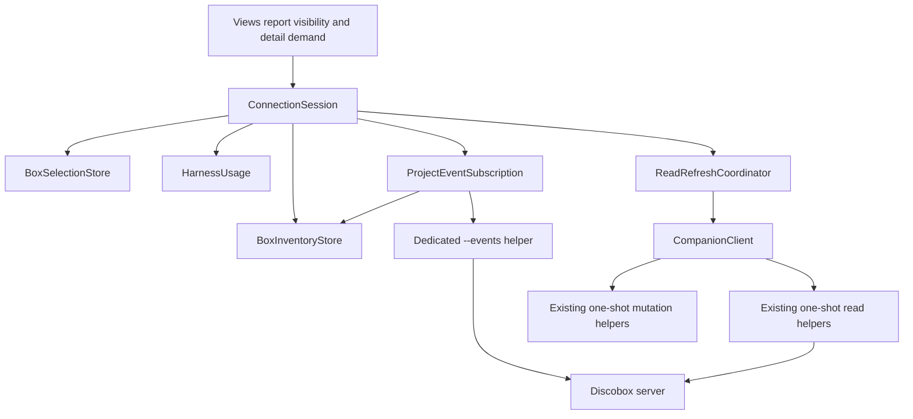

# Polling, event updates, and companion transport plan

**Local implementation.** The desktop now subscribes to one DB-backed project event stream per connected host.
Replay commits at its checkpoint. A listing supplies repository, title and pool report metadata, while stream interruptions restore the DB-only listing cadence.
Exec and service reads follow pane demand, share admission by project/pool across profiles and back off independently.
Terminal recovery uses the helper-local delay described in A2.

Usage follows audit write cursors per pool and provider while a usage surface is visible.
The initial recent window fits the available descriptor capacity (up to 64 rows). Forward pages contain up to 100 rows.
A full queue resumes from the last retained candidate. A daily bounded tail check after catching up detects a replaced audit database.
Settings → Diagnostics controls scheduled reads, reports outstanding helper reads, and shows whether a terminal recovery change requires relaunch.
The workspace footer identifies active overrides. A manual refresh remains available in the workspace, approvals and Usage Details.
The optional persistent reader and shared terminal reconnect permits still require workload measurements. Stored inventory for running boxes requires the upstream contract below.

Local verification on November 17 passed `make ci` with 258 Swift tests, Go race tests,
vet, and signed release packaging. The offline native terminal, terminal recovery,
input, approval workflow, multi-host and feature fixtures passed. The command fixture
lost the active key window while exercising the Services shortcut. That keyboard
sequence still needs an uninterrupted foreground run. The selected-terminal read
counts were measured against fixtures. A local and Iroh comparison can measure
steady-state traffic and time to recover from an ordinary disconnect.

For a local comparison, quit the app, run
`defaults write ai.discobox.desktop DiscoboxDisableAutomaticGuestReads -bool true`,
and relaunch. Quit, run
`defaults delete ai.discobox.desktop DiscoboxDisableAutomaticGuestReads`, and
relaunch to restore normal operation. Count the `read_execs`, `read_services`,
`read_usage`, `read_usageHeaders` and `read_auditBody` events by trigger in
`~/Library/Logs/Discobox/diagnostics/`. Attach helpers record `attach_wait` and
`attach_dial`. Each usage listing operation now queries one provider in one pool.

**Baseline:** UI `2a9b024`, pinned Discobox `190d5647a52577705ad3a82ab3c623bd656ff16d`.
This plan addresses all five findings from the polling and VM-stall review.
Terminal sizing has a separate [presentation plan](TERMINAL-PRESENTATION-PLAN.md)
and is outside this change's review and delivery dependencies.
It supersedes the persistent-companion implementation outline in
[the earlier follow-up](APPROVAL-AND-COMPANION-FOLLOWUPS.md). The approval review
model work in that document remains separate.

## Decision and scope

Separate host state observation from guest detail reads. Use project events for
box lifecycle/activity, fetch terminal and service inventories only where needed,
back off guest failures and collect usage incrementally. Ship the guest-load
reduction first. Add a small defaults-based A/B control and counters alongside it;
neither a Diagnostics settings pane nor a transport rewrite blocks that work.
Use a dedicated `--events` companion mode for SSE. A persistent, multiplexed
read companion is an optional optimization, gated on measurements at the new
read rates, not a prerequisite for event support or any guest-load reduction.

The reported upstream diagnosis attributes the VM crash to hairpin NAT inside
the platform. Remediation belongs in platform networking. Assess the desktop
changes by guest reads per minute, freshness of visible data and time to restore
a usable terminal after a disconnect.

The current event payload contains lifecycle, name, tags, error and primary-agent
activity. It does not contain complete exec/service inventories or notifications
for every change to those inventories. The initial client implementation therefore
retains slow, demand-limited detail reconciliation. A separate upstream event
extension is required before that reconciliation can be removed safely.

## Ownership

- `ConnectionSession` composes owners and connects/disconnects them. It stops
  chaining `inventory.refresh()` to `selection.refreshDetails()` unconditionally.
- `BoxInventoryStore` owns box metadata, event projections, purge tombstones and
  freshness. `BoxSelectionStore` owns selection and independently published exec
  and service results. Neither store owns a periodic timer.
- A per-session `ReadRefreshCoordinator` owns demand, deadlines, in-flight read
  coalescing and backoff. Keys include connection generation, project, box/pool,
  and resource. It holds no copy of the box list or selection. Metadata admission
  and cooldown are shared across that app's sessions for the same server/pool;
  individual views must not each get their own allowance. Terminal helpers first
  get independent local recovery backoff in A2. Extending the app-wide gate to
  them is a separate, measurement-gated delivery, not a promise of A's budget.
- `ProjectEventSubscription` owns its cursor, replay state and reconnection. It
  publishes typed events into the inventory store, not through a global event bus.
- `HarnessUsage` owns quota snapshots, per-pool/provider cursors and bounded
  pending recording reads. Helpers have no authoritative application cursor/cache
  state, so restarting them cannot silently lose progress.
- Views bind to these models and report demand; they do not add refresh timers.
  Existing terminal, desktop and port-forward owners remain separate.

## 1. Remove automatic three-second guest detail reads

Implement the separation first using the current request transport. Event support
then replaces the host-state observation path without changing detail ownership.
Selection, explicit refresh and mutation receipts all use the same coordinator;
none should bypass its coalescing, scope or failure checks.

Initial defaults, with intervals measured from completion and modest nonnegative
jitter so it cannot increase the stated maximum steady-state request rate:

| Resource | Focused, selected host | Visible but unfocused | Hidden or unselected host |
| --- | --- | --- | --- |
| Box lifecycle/activity | Project SSE subscription | Same subscription | Same subscription |
| Full box metadata | DB-only reconciliation every 60 s | Every 60 s | Every 300 s |
| Selected running box's execs | On demand; 30 s reconciliation while a terminal pane is visible | 60 s while visible | No automatic reads |
| Services | On opening a stale services panel; 60 s while that panel is visible | 120 s while visible | No automatic reads |
| Usage | Incremental refresh no faster than 60 s when a usage surface is visible | Same | Paused |

Keep the current DB-only inventory cadence as the compatibility fallback when a
server definitively does not support SSE. Do not reintroduce guest detail reads
through that fallback. Transient SSE disconnects use bounded reconnect backoff;
they do not repeatedly probe capability or trigger a tight full-refresh loop.

Detail triggers:

- Selecting a box fetches missing/stale details once. Reuse a fresh warm cache;
  a known invalidation always overrides its age. Fetch execs independently of
  services so service discovery cannot delay an interactive terminal.
- Opening Services requests its inventory if missing or older than 30 seconds.
  The service shortcuts may continue using the existing reported-port discovery;
  that DB-only forwarding path must not force service-inventory polling.
- Successful shell/service mutations invalidate only the affected resource and
  request one refresh. An unknown mutation outcome is never automatically replayed.
- A terminal-ended transition can invalidate execs once. Do not turn every ping,
  reconnect attempt or program-status event into an inventory request.
- Becoming visible revalidates stale demanded data once; repeated focus changes
  coalesce. Switching hosts/boxes withdraws obsolete demand and cancels its reads.
- Stopped/archived selections fetch saved inventories when requested, not on a
  recurring timer. Neither a stale snapshot nor event-stream health authorizes
  terminal input. Keep the existing live attach checks. A2 adds helper-local
  recovery backoff; shared admission for attach checks is a separate follow-up.

### Project event handling

Use one subscription per connection generation/project. Implement `Last-Event-ID`,
server retry hints, comments/heartbeats, ID-only cursor frames and `reset`. Advance
the applied cursor only after a frame is accepted by the corresponding store.
Keep the cursor in memory and clear it when the project/server identity changes.

Implement a narrow `--events` mode alongside `--forward` and `--attach`, using
the existing effective endpoint, including the shared Iroh proxy. It holds one
SSE request and emits versioned, typed JSON lines on stdout: event, checkpoint,
reset, heartbeat/retry metadata and terminal error. Do not flatten ID-only frames
into empty events or discard them. Swift owns the applied cursor and restart
backoff; the helper opens one connection per launch and does not run a second
independent reconnect loop. Keep diagnostics on stderr/the diagnostic log.

Reuse the long-lived process ownership pattern, not the finite request timeout.
Bound each decoded SSE event/JSON line and the Swift pending-event queue; parse
off the main actor. On overflow or blocked output beyond a bounded deadline,
close the subscription and recover from the last applied cursor. Stdin EOF,
owner cancellation and process exit close the HTTP body/socket, including while
stdout is blocked. The mode has no management permissions or generic request
dispatch. Fixture tests cover a stalled reader and owner shutdown. One idle
event helper per connection is acceptable; it adds no guest requests.

Subscribe first. Build initial/replacement event state in a bounded staging map;
the ID-only replay-complete checkpoint commits it atomically. Hydrate fields not
present in events from the DB-backed box list/detail route. Hydration must never
overwrite newer event-owned lifecycle/activity fields. Creation needs metadata
hydration; deletion creates a tombstone. A late list cannot resurrect a deletion.
On reset, old rows remain visibly stale until replay completes; missing IDs in a
completed replay are removed. Do not infer absence from a partial replay.

Coalesce event publication onto the main actor. An event buffer overflow closes
the subscription and resumes/rebuilds from a known applied cursor; it never drops
events while claiming current state. Preserve connection/selection generation
checks, including identical IDs on different computers. A heartbeat proves the
stream is alive, not that a guest's old activity/resource report is fresh.

No event callback calls the old combined `refresh()`. A primary-agent activity
change updates its row directly; it must not cause two new guest requests.

### Upstream extension for removing the remaining fallback

Request a capability/versioned extension to the existing stored inventory, not a
new live fan-out API. At this pin, `ReadSandboxInventory` already reads the stored
execs/services, but routing uses it as the fallback for a non-running box. Ask
Discobox for:

1. An explicit stored-only read for running and stopped boxes alike, returning
   exec/service metadata, `revision` and `observedAt`, without acquiring a guest
   connection or waking a box. Preserve existing authorization scopes. Missing
   inventory is an explicit unavailable result, never an implicit live fallback.
2. The corresponding inventory revision in project event replay and updates.
   Commit the snapshot/revision and its event consistently so an advertised
   revision is readable. Define reset/epoch behavior; do not order opaque hashes
   or timestamps as though they were monotonic sequence numbers.
3. A documented freshness contract: which changes trigger reports, what happens
   on pool failure or missing inventory, and how confirmation of unchanged data
   advances `observedAt`. Keep live checks for actions/attach; a stored exec marked
   running remains an observation, not permission to send input.

The pinned pool already calls `reportInventories` on its 15-second status tick
(`pool-agent/statuspoll.go`, `inventorypoll.go`). Digest-only confirmations advance
observation time. That is a nominal cadence, not a 15-second freshness guarantee:
reads/reports can fail or lag, old agents can lack inventory, and oversized
inventories are not posted. Confirm intended freshness with upstream before
choosing stale-state thresholds. This existing pool collection still reads the
guest; eliminating UI display reads does not eliminate all pool traffic.

The stored document also contains terminal screens and exec environments. The
display endpoint/event must not ship those fields unnecessarily. Prefer a
revision for exec/service display metadata; using the whole-document digest can
turn screen-only changes into needless metadata fetches. For unchanged metadata,
carry an observation timestamp or reconcile it occasionally via DB-only reads.

When that capability is present, replace the 30/60/120-second detail timers with
revision-triggered, coalesced snapshot reads. Test gaps, reset/replay, stopped boxes
and mutations from other clients. Older servers retain the bounded fallback above.
This extension is a separate upstream deliverable, not a claim about today's SSE.
Send the proposal early; client adoption need not wait for the optional persistent
reader or for the full Diagnostics UI if the API becomes available sooner.

## 2. Back off failing guest reads independently

Track execs and services separately: last success, last attempt, failure count,
next eligible attempt, error classification and the in-flight task. A successful
box-list request cannot clear either resource's failure state. Publish one result
without awaiting the other, and retain prior values with their original timestamp
when a read fails; never replace them with an empty successful result.

- Transient timeout/transport failures: retry delays of 30, 60, 120, 240 and 300
  seconds, with jitter capped at five minutes and never shorter than that
  resource's normal demand interval. Failure must not increase traffic. Keep the
  existing bounded request deadline; do not compensate by extending timeouts.
- After repeated failures, allow only one probe after the cooldown. If the panel
  is no longer demanded, there is no probe until demand returns.
- Share a pool cooldown for repeated pool transport timeouts so switching boxes
  cannot evade it. Do not apply that cooldown to DB-only host reads or interpret
  a missing service/terminal as a pool outage.
- Limit automatic guest metadata work to two in-flight reads per pool, shared
  by execs, services and usage. Prioritize visible terminal inventory over usage;
  reserve pool probes during cooldown so independent callers cannot stampede it.
  This budget excludes terminal attach/reconnect traffic and explicit mutations.
  A2 bounds recovery separately per helper; only a later shared attach gate can
  bring its live observations into the same two-read limit.
  It bounds this app's outstanding requests, not leaked server-side connects,
  other app instances, the CLI or the pool's own polling. It is client restraint;
  real guest-wide admission and cancellation belong to the upstream server fix.
- Authorization/certificate errors require user action. Unsupported endpoints
  become a capability result. A missing/stopped target reconciles its lifecycle
  instead of retrying the same detail request indefinitely.
- Explicit Retry may request one immediate, coalesced probe. Disable duplicate
  retries while it runs and impose a short minimum retry spacing. It does not
  erase failure history until a successful response arrives.
- Cancellation because demand/generation changed is not a failure. Scope checks
  still reject replies after cancellation or reconnection.

Show the problem near the affected surface: “Terminal list unavailable · retrying
in …” or “Services last updated …”, with Retry. Keep the attached terminal usable
and previously captured text copyable. A service-list failure must not disable an
otherwise healthy terminal or mark every box offline.

### A2: helper-local terminal recovery backoff, separate from A

`RequireRunning` makes a live exec GET before each physical attach. In addition,
`attachDone` makes another live exec GET at the start of each resume attempt,
before the resumable client's own wait. The pinned resume package caps that wait
at five seconds (`pkg/execstream/resume/client.go:150`). That is not a fixed
five-second cycle: check/dial latency is additional, and failed checks can prevent
later calls. Where both hooks reach their live checks, each attempt includes two
guest exec GETs plus an attach dial. Other lifecycle GETs are host-only; do not
count them as guest connections. Hidden retained sessions also recover, up to
eight hidden sessions per computer plus presented sessions.

Ship A's detail-loop removal without changing this inter-process boundary. A2
uses the existing `Done`, `Dial` and connection-event hooks to add one recovery
state per helper. The desktop maintains a visibility marker beside the existing status FIFO.

- A transport failure/recovery entry establishes a shared `nextEligibleAttempt`
  before either hook makes a live observation. A terminal visible at the time of
  loss gets one expedited retry after 1–1.25 seconds. Hidden terminals start at
  the normal backoff. Repeated failures wait approximately 30, 60, 120 and 240
  seconds, then 270–300 seconds, with jitter.
  Wait cancellably before starting the bounded HTTP request timeout. An explicit
  first attachment is immediate; this delay applies to automatic recovery.
- `Done` and `Dial` share attempt/failure accounting, not independent sleep loops.
  If `Done` fails with a transport error, mark that attempt failed and make its
  following `Dial` return without another live check or socket dial. Schedule the
  next eligible attempt once. The resume loop currently ignores a nonterminal
  `Done` error, so simply returning that error is insufficient to prevent `Dial`.
- Do not reset on a successful host-only check, exec GET or socket open. Complete
  resume/replay first and require a stable connected interval (initially 30 s)
  before clearing accumulated failures; rapid disconnects must not reset the
  policy to its shortest wait. Cover failed replay/establishment as well as dial
  failure so successful TCP/WebSocket setup alone cannot bypass backoff.
- Cancellation stops waiting immediately. Authorization failures, protocol
  rejection and a known ended/stopped target retain their existing terminal
  handling; they are not transient retry opportunities. Preserve output and
  report waiting/retry timing through the existing status/diagnostic path.
- **Reconnect now** stays available during automatic backoff. It checks that
  the displayed session still owns the attachment, saves its output and replaces
  it once. A delayed click after automatic recovery leaves the healthy stream open.

This reduces each helper's retry rate, but several helpers can still retry at
once. Counters must identify automatic recovery by attachment and pool. Test
multiple visible/hidden helpers, but do not assert a pool-wide two-read bound for
them until shared admission is implemented.

### Conditional follow-up: shared attach admission

If A2's measurements still show aggregate terminal recovery competing heavily
with metadata reads, add the app-owned pool gate across helpers. Use a narrow
private control channel separate from terminal bytes and the best-effort status
FIFO: request permit, grant/deny, report completion/failure. Scope and bound
permits by connection generation, pool and attachment; release on cancellation
or owner/helper death. Gate both hooks and the automatic recovery attempt, while
leaving established streams outside the finite-read budget. A missing owner must
not silently bypass admission. This work has its own protocol/lifecycle tests
and is independent of the optional generic persistent reader.

### Optional upstream reconnect follow-up

The shared resume package caps reconnect delays at five seconds and runs
`Done` before the wait. If measurements show excessive attempts across clients,
report their count and timing in a separate reconnect issue. A configurable
policy could gate both the observation and dial while respecting cancellation.

## 3. Make usage reads incremental and bounded

Use the existing audit API's `poolId`, `host`, ascending order and
`after=pool:recordID` support. Scope cursors by connection generation, project,
pool and provider host; one provider's cursor cannot skip another's records.
Keep these cursors in Swift, not the short-lived request handler.

1. Seed each relevant pool/provider once from at most the latest 200 records,
   preserving the current bounded-history behavior. Report that bound if no
   usable recent quota was found; do not present missing data as zero usage.
2. Subsequent reads advance in write order from the per-pool cursor, initially
   using 100-row pages. Do not use a single advancing timestamp across pools.
   For a newly discovered pool, bootstrap independently. An unavailable pool
   retains its cursor and receives its own cooldown.
3. Bound an entire refresh to four pages and the existing 20-second collection
   budget, with one pool query in flight. Round-robin pending pools/providers so
   a busy pool cannot consume every cycle. Stop at the budget and resume later;
   report “Catching up” rather than silently skipping the backlog.
4. Derive cursor progress from every raw row examined, including rows rejected
   by the quota filter. The companion returns candidate descriptors and scanned
   cursors, not just matching quota rows.
5. Commit a scanned cursor only once the corresponding candidates are processed
   or retained in a bounded pending queue. Keep retryable body/header reads there
   after advancing the listing cursor. If that queue fills, stop consuming pages;
   never advance past candidates that were discarded for lack of space.
6. Keep at most 64 pending descriptors and at most four body/header reads per
   cycle. Coalesce newer quota candidates for the same harness/provider when
   doing so preserves the displayed windows. Permanent recording loss is a
   visible missing-data result, not an endless retry.
7. Pause when no usage surface is visible, including a collapsed sidebar section
   with no Details window open. On return, resume from cursors without replaying
   all historical pages. Avoid simultaneous bursts from multiple computers.

Initial seeding is intentionally bounded, not a complete audit export. Treat
unsupported cursors, retention gaps and pool resets explicitly: mark stale and
perform a bounded reseed for that scope. Do not reinterpret an arbitrary HTTP
400 as proof that the server lacks cursor support. Where the API cannot identify
a reset, retain a low-frequency bounded reseed/manual refresh escape hatch.

The recording bodies are already read only for quota parsing. Never persist or
log them as part of these diagnostics; no provider API calls or login changes
are introduced by usage collection.

## 4. Add small A/B instrumentation; build the Diagnostics UI later

The first slice is a normal-app defaults key,
`DiscoboxDisableAutomaticGuestReads` (absent/false by default), plus operation
counters in the existing rotating diagnostic log. Read the key at launch, record
its value prominently in the startup diagnostics, and document both enable and
remove/reset commands. It disables automatic detail and usage reads at dispatch,
including automatic work triggered by focus/events, **and automatic terminal
recovery**. Pass the launch policy to every attach helper as a narrow option.
On disconnection, stop before `Done`, `RequireRunning` or a new attach dial; retain
copyable output and show that automatic reconnect is paused. Do not tear down a
healthy stream. Initial requested reads/attachments, explicit refresh and manual
Reconnect remain possible and are counted separately. Test retained hidden
helpers as well as the visible terminal. Using a launch-time
override avoids building runtime cancellation/settings UI just to run the first
A/B. Add the counters with the demand changes if practical; do not delay the
traffic reduction to finish a diagnostic feature.

The later Settings → Diagnostics UI exposes automatic guest-detail and usage
refresh independently, and a “Manual refresh for polled data” mode. Automatic
reconnect also has its own clearly displayed policy; until an existing-helper
control mechanism is implemented, changing it requires app restart, rather than
claiming a runtime switch affected already-running helpers. The manual mode
pauses scheduled metadata/approval reads too, but **keeps project SSE running**.
The stream is database-only; stopping it adds no value to the guest-load A/B.
Explain that polled approval notifications may be stale in this broader mode.
Show a quiet persistent indicator and an obvious return-to-normal action while
an override is active. Represent startup and runtime overrides in the same policy
so the UI cannot claim reads resumed while a hidden defaults key keeps them off.

Only this later runtime control withdraws queued background reads, cancels
in-flight eligible reads and exposes live counts. The dispatch gate remains the
authority: event/focus callbacks cannot reschedule disabled work. Cancellation
cannot undo a request already received by the server; counters distinguish
client completion/cancellation from any server-side work still stuck.

Explicit refresh, initial connection/selection reads and user actions remain
available and labelled by trigger. Terminal streaming, desktop traffic and port
forwarding remain unchanged. Safety checks on initial/manual attachments stay
mandatory and separately counted. With the startup override, automatic recovery
checks/dials are absent; without it they use A2's helper-local backoff once A2
ships. Do not describe either mode as “zero guest traffic”: healthy streams,
forwards, explicit actions and non-UI clients still exist. No approval decision
is retried by a mode change.

Record operation, captured computer/generation/box/pool IDs, trigger reason,
attempt/completion/cancellation counts, duration, bytes, in-flight count, backoff,
helper starts and SSE reconnects. Exclude terminal text, tokens, request bodies,
response bodies, headers and arbitrary URLs. Reuse the existing bounded rotating
diagnostic infrastructure and structured error categories.

A/B procedure: same build, foreground workspace, selected computer/box, terminal
workload and other clients. Initially compare normal against “automatic details,
usage and terminal recovery off”; avoid the ambiguous label “both off.” Add
independent comparisons with the later UI. Keep the same established
terminal/forward workload; during a stall, recovery traffic intentionally differs
between modes. Verify counters for each category, including retained sessions,
before interpreting results.
Where server instrumentation is available, compare client request counts with
VSOCK connection starts, completions and time outstanding. Record how long
the user waits for the terminal to become usable again.

## 5. Measure before choosing a persistent read companion

This is a conditional optimization, not a committed prerequisite. Measure helper
launch count, CPU/wakeups, startup/handshake time and user-visible read latency
after demand reduction, SSE and incremental usage ship. Attribute time spent
starting the helper separately from time waiting on the host or guest. Proceed
only if helper overhead is material in a reproducible workload and a prototype
improves it without weakening isolation/cancellation. Otherwise record the
decision to retain one-shot reads and close this finding with that evidence.

The design below is reserved for that decision. It must not hold up the stored
inventory API, events, terminal sizing or any guest-load reduction.

Add a persistent read mode to the existing executable, one per logical connection
generation. Keep the current shared Iroh proxy and reuse its effective endpoint.
Replace the read worker when that endpoint changes. Writes, shell launches and
long/sensitive review or transfer operations stay on existing one-shot paths.
Start with an explicit allowlist of routine reads;
do not expose arbitrary HTTP or a permanently management-enabled helper.

### Transport contract

- Versioned, length-prefixed JSON frames with a handshake, a random session ID
  and distinct transport correlation IDs. Existing approval `requestID` keeps its
  domain meaning. Use standard JSON codecs and a small documented framing layer.
- Request, response and cancel message types.
  Publish the transport schema alongside the existing operation registry and
  verify both Swift and Go against fixtures.
- Initial limits: 128 KiB request bodies, the existing 8 MiB decoded response
  bound, four executing reads, 16 queued requests and a 32 MiB aggregate response
  buffering budget. Split response delivery into bounded frames; give control
  messages priority between chunks. Enforce limits on both
  ends, including encoded/base64 overhead, before allocating a declared payload.
- Per-request cancellation/deadlines; terminating one request does not kill its
  peers. All continuations complete exactly once on response, cancellation,
  deadline, protocol error, worker exit or owner invalidation.
- Read/write pipes and JSON processing stay off the UI actor and Swift's
  cooperative executor. Keep one serialized frame writer per direction.
- Reuse an immutable HTTP transport configuration. The current per-operation
  `configure(client)` mutates timeouts and must not run against a shared client
  concurrently. Use per-request contexts and fixed client profiles; leave long
  special operations on the one-shot path until explicitly supported.
- EOF, parent death and disconnect close the stream, cancel reads and release
  sockets. Worker death fails outstanding reads once; the scheduler may issue a
  fresh eligible read after backoff. Do not automatically replay every request.
- A matching bundled helper is required. A protocol mismatch is actionable;
  an unexpected failure must not silently spawn one-shot processes forever.
  A documented diagnostic transport override can compare the old/new paths.

Keep the dedicated event helper initially, preserving its independent lifecycle.
Combining it with the reader would be a separate measured optimization requiring
event/control fairness and overflow recovery. It is not needed to reuse finite
read processes or to adopt SSE.

## Implementation sequence and review boundaries

| Delivery | Work | Exit criteria |
| --- | --- | --- |
| A | Demand reduction and independent failure handling (sections 1, 2; former stage 2) | No hidden/unselected automatic detail reads or three-second guest loop; metadata-only admission, bounded retries, partial results and coalescing tests pass. No attach protocol dependency. |
| B | Defaults A/B switch and log counters (small section 4; former stage 1) | No automatic detail/usage reads or terminal recovery in the disabled mode; initial/manual work is separately counted. Can land with A, without blocking it. |
| A2 | Helper-local recovery backoff (section 2) | One quick retry for a visible terminal, conservative hidden retries and one cancellable wait per attempt. Failed observations suppress the dial. |
| C | Current project SSE via `--events` (section 1; former stage 5) | Replay/reset/deletion and metadata hydration are race-safe; activity events trigger no guest reads; shutdown closes blocked streams; DB-only fallback works. |
| D | Incremental usage (section 3; former stage 3) | No candidate loss across cursors; page/body limits hold across pools; unavailable pools/backlogs remain visible. |
| E | Full Diagnostics UI (remaining section 4) | Runtime cancellation/gating and in-flight display work; SSE stays connected in manual mode; overrides are visible and reversible. |
| Conditional after A2 | Shared attach permits (section 2) | First establish excessive aggregate helper recovery traffic. Then extend pool admission to both hooks with bounded, scoped permits and owner-death/cancellation tests. |
| F, conditional | Persistent read transport (section 5; former stage 4) | First show material helper overhead at the new rates. If justified, protocol/isolation/cancellation/overload/death tests and measured benefit must pass. Otherwise retain one-shot reads. |
| Upstream-dependent | Stored inventory plus event revision (section 1; former stage 6) | Display uses DB-only snapshots; external changes, stale reports, missing inventories and reset/replay are handled. No dependency on F. |

Ship **A → small B → A2 → C → D → E**, allowing A and B to land together. A2
must not hold up A; its shared-permit follow-up is conditional on measurements,
as is F's persistent reader. Request the upstream contract now and adopt it when
available; it is not queued behind either optional protocol. A–E, including A2,
can ship against the current pin. Terminal sizing has a separate review/plan.
The slower compatibility detail
reads remain until the upstream contract lands.

Likely code boundaries: `PollingCadence`, `ConnectionSession`, `BoxSelectionStore`,
`BoxInventoryStore`, `Connections`, `HarnessUsage`, `CompanionClient`; new Core
coordinator/event types; desktop demand, terminal recovery policy and diagnostics;
companion `internal/bridge`, `internal/terminal`, and a narrow events package.
New inter-process request protocols occur only if shared attach admission or the
persistent reader is justified; launch options and existing status records suffice
for the initial A2/B work.
Keep each stage in a reviewable commit with its own evidence and rollback path.

## Acceptance and validation

Use injectable clocks and fixture servers; avoid timing-sensitive sleeps in unit
tests. Cover focus/occlusion/host changes, overlapping selection and manual reads,
per-resource failure isolation, retry caps and no mutation replay. For A2, cover
shared Done/Dial accounting, failed replay, flapping, cancellation while waiting,
hidden helpers and the launch-time disable policy. Attach-permit lifecycle tests
belong only to the conditional shared-gate delivery. For usage,
cover late-written records, identical timestamps, multi-pool IDs, truncated pages,
pool outages, pending-body failure and budget exhaustion. For events, cover
fragmented frames, duplicate/out-of-order IDs, ID-only frames, reset, creation,
deletion, reconnect and metadata hydration races. For `--events`, cover oversized
lines, full queues, parent/helper death and cancellation during a blocked stdout
write. Only if the persistent reader is implemented, add multiplexed partial
frames, worker-death, overload and request-permission tests.

On macOS, run approval, terminal, command and multi-host smoke fixtures through
the production composition. Verify typing/copy, shell creation/closure, Services
updates and notification behavior under delay and disconnection. Run `make ci`
and verify release builds contain no smoke code. Avoid deliberately stressing the
user's working VM; start with isolated transport fixtures, then a controlled pool.

Turn the budgets into regression assertions, not just rollout observations. Use
a virtual clock, completed bootstrap, immediate-success fixtures, deterministic
zero jitter and half-open time windows to avoid endpoint double counting. The
steady-state detail counts exclude initial/explicit reads, usage and terminal
transport; each excluded category still has separate counters.

| Scenario | Required assertion |
| --- | --- |
| Focused terminal, Services closed, ten simulated minutes | At most 20 automatic exec reads and zero service reads, versus roughly 400 combined reads at the old cadence. |
| Focused terminal, Services open, ten simulated minutes | At most 20 exec reads plus 10 service reads. |
| Hidden/unselected box over the same interval | Zero automatic detail reads; focus/event bursts cannot bypass the gate. |
| Repeated metadata timeouts across multiple resources/boxes in one pool | Dispatches obey per-resource retry deadlines; no more than two coordinated metadata reads are outstanding and only one metadata probe is admitted during cooldown. Host-list success does not reset these failures. Attach helpers are outside A's aggregate bound. |
| A2 helper recovery, including hidden sessions | The first visible retry waits 1–1.25 s. Hidden and subsequent retries follow exponential backoff capped at five minutes. A transport failure in `Done` suppresses that attempt's `Dial`. Flapping/replay failure preserves the accumulated backoff. |
| Shared attach gate, only if implemented | Recovery observations join the aggregate pool admission/cooldown; permits are released on cancellation or helper/owner death. Established streams remain usable. |
| Defaults automatic-guest-reads override | Zero scheduled detail/usage dispatches and zero automatic recovery observations/dials after disconnection, including hidden helpers. Initial/manual attachments retain mandatory safety checks and separate counters; healthy streams are not closed. |
| Stable event connection, including manual-refresh mode | Exactly one SSE subscription/helper per connection/project generation; no guest reads for lifecycle/activity events. |
| Incremental usage cycle | At most four 100-row pages and four recording reads, with at most 64 pending candidates; known pages are not repeatedly fetched and cursor progress never skips unretained candidates. |
| Stored-inventory-capable server | Periodic display reads never acquire a guest lease; revision events fetch only demanded stored metadata. |
| Optional persistent reader, if justified | One finite-read worker per connection generation and no helper launch per finite inventory read. This is not a requirement of the initial one-shot implementation. |

Report client request counts and server connection measurements separately.
The platform team owns verification of the hairpin NAT fix.
