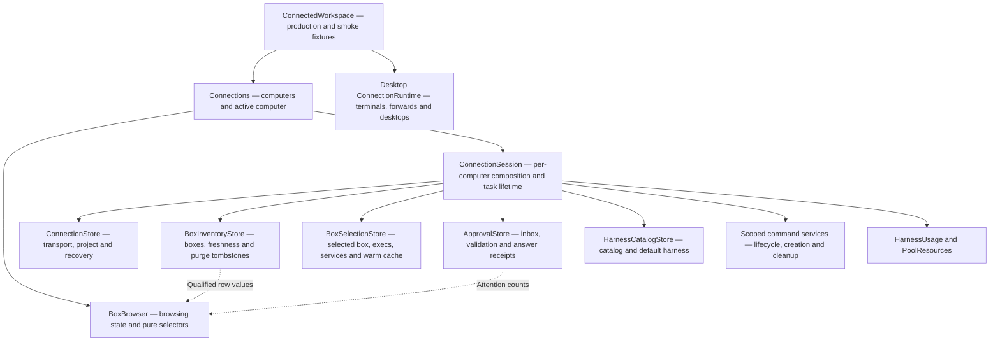

# Workspace ownership and production UI consolidation

**Status:** All six implementation stages completed locally, November 17, 2026.
The final validation record and native keyboard limitation are below. The
findings describe the pre-refactor baseline; the implementation record follows.

**Priority:** P1 architectural remediation. This addresses duplicated behavior,
unrepresentative UI coverage, unused polling, and unclear ownership independently
of any current performance incident.

**Baseline:** UI revision `cd59939`. See the [architecture overview](../ARCHITECTURE.md)
for the current wider stack. The design sections retain the original plan;
the implementation record describes the completed changes and verification.

## Decision

Use one production workspace composition for every computer count, including
smoke fixtures. Make `BoxBrowser` the only owner of browsing state and policy.
Replace the current `Workspace` with stores whose lifetimes and responsibilities
are explicit, composed by `ConnectionSession`.

Keep the existing Swift Observation, main-actor state ownership, async tasks,
and `DiscoboxClient` boundary. This does not introduce a state-management framework,
an event bus, or a new transport. The objective is understandable ownership and
representative tests, not a particular number of classes or lines per file.

`Workspace` can act as a temporary forwarding facade during migration. The final
stage removes it and its consumers; a permanent facade exposing every store's
state and operations would recreate the original problem.

## Confirmed reasons for the change

| Finding | Evidence | Design consequence |
| --- | --- | --- |
| Broad state and lifecycle ownership | `Workspace` has 43 public observable stored properties and eight UUID lifetime/request tokens. It coordinates connection, inventory, selection, approvals, catalog, creation, and cleanup. | Each mutable state value, task, cache, and invalidation token needs one named owner. |
| Two workspace UI paths | Production constructs `ConnectedWorkspace`; two `FeatureSmoke` fixtures construct `WorkspaceView` without `Connections`. That enables a second sidebar and a view-owned approval poll. | Fixtures must supply a one-host production composition rather than an alternate UI. |
| Browsing drift | `Workspace` has filter/search state and five switcher ranks. `Connections` calls that switcher and sorts again using three ranks and qualified power state. | Consolidate policy before deleting its existing callers. |
| Unconsumed work | `refresh()` reaches `refreshScreen()` for non-live selections. Desktop never reads its `screen`; `ConsoleView` separately calls `terminalSnapshot`. | Delete background snapshot polling while retaining the actual saved-output feature. |
| Incomplete boundaries elsewhere | `FileBrowser`, `HarnessManagement`, `ApprovalQueue`, and `BoxStartIntent` retain `Workspace`. UI settings also call its generic `operation` method. | Removing fields alone is insufficient; consumers need narrow, explicitly scoped interfaces. |

Sources: [session composition](../Sources/DiscoboxCore/ConnectionSession.swift),
[Connections](../Sources/DiscoboxCore/Connections.swift),
[workspace view](../Sources/DiscoboxDesktop/WorkspaceView.swift),
[smoke fixtures](../Sources/DiscoboxSmoke/FeatureSmoke.swift),
[terminal panes](../Sources/DiscoboxDesktop/BoxWorkspaceView.swift).

## Proposed ownership



Arrows describe ownership or explicit inputs, not a global notification system.
Stores do not hold `Connections`, `ConnectionSession`, or the old `Workspace`.
They cannot discover the globally selected computer while processing a request.

| Owner | State and work it owns | Boundary |
| --- | --- | --- |
| `Connections` | Saved/live sessions, active computer, cross-computer navigation, creation reminders. | Aggregates computers; does not implement per-host refresh, approvals, or transport. |
| `BoxBrowser` | Computer/lifecycle/activity/tag/search filters, bulk selection, reveal requests, sidebar/switcher ordering, contextual pins and counts. | Pure queries over supplied row values; no client, I/O, polling, or server mutations. Creation operations remain outside it. |
| `ConnectionSession` | Composition, connect/disconnect orchestration, and the existing per-host refresh loops. | Coordinates explicit transitions; does not accumulate copies of domain state or generic feature operations. |
| `ConnectionStore` | Client, resolved project, endpoint labels, transport endpoint, connection generation, attempt/recovery state and errors. | Supplies scoped access to typed services. It does not own boxes, approvals, or selection. |
| `BoxInventoryStore` | Box list, observation time, list request ordering, generation-scoped confirmed-purge tombstones. | Publishes inventory and freshness; does not select a box or start an exec. |
| `BoxSelectionStore` | Selected box/exec IDs, exec and service inventories, their errors/freshness, selection tasks, warm cache, successful terminal-inventory notifications. | Uses explicit box state and operation scope. Owns no Ghostty surface, sidebar filters, or approval timer. |
| `ApprovalStore` | Pending inbox, refresh ordering/error, request validation, submission state, acknowledgement handling. | Approval review is bound to its original host/project/generation. No implicit access to current selection. |
| `HarnessCatalogStore` | Catalog, read age, coalesced load task, default harness, catalog errors. | Shared per-host metadata; independent from an individual harness review window. |
| Scoped command services | Creation, lifecycle/bulk operations, pool cleanup, and their pending-operation state. | Explicit targets and collaborators for affected stores; no general-purpose mutable workspace. |
| Existing feature models | Usage/resources, file navigation/transfers, harness review, audit history. | Keep their own state; replace broad workspace dependencies with only the access and validity checks they require. |
| Desktop `ConnectionRuntime` | Ghostty sessions, forwards, desktop windows. | Remains in Desktop. Receives narrow lifecycle/inventory inputs from the selected host's stores. |

For cross-store actions, use specific services such as `BoxCommands` and
`PoolCommands`. Do not put every action into a new catch-all coordinator.
`ConnectionSession` coordinates session lifecycle and refresh ordering; command
services coordinate their own bounded use cases.

## Interface and lifetime rules

### Captured scope instead of looking up the active workspace

Use the existing two identity concepts explicitly: a stable computer identifier
(currently the normalized connection endpoint) and a generation for a particular
connection/project lifetime. Selection has a separate revision.

Illustrative contracts, to be implemented incrementally:

```swift
struct SessionScope: Equatable, Sendable {
    let computerID: String
    let generation: UUID
    let projectID: String
}

struct BoxTarget: Equatable, Sendable {
    let scope: SessionScope
    let boxID: String
}

struct TerminalTarget: Equatable, Sendable {
    let box: BoxTarget
    let execID: String
}

// Representative API shapes, not complete declarations:
// inventory.refresh(using: capturedSessionAccess)
// selection.select(boxID: ..., using: capturedSessionAccess)
// snapshots.load(target: TerminalTarget)
// approvals.review(request: ApprovalTarget)
// approvals.answer(review: CapturedApprovalReview, decision: ...)
// boxCommands.perform(action: ..., target: BoxTarget)
```

Internal session access captures the client and project associated with the
scope, plus a narrow validity check. Desktop views receive typed services, not
the client or an unrestricted `operation(BridgeRequest.Operation, ...)` method.
Each service rechecks its scope before submission and after asynchronous reads.
Each read-owning store also checks its own request revision before publishing.

Use the existing approval payload/fingerprint validation in the companion; these
Swift interfaces do not replace server authorization. Do not change upstream
request schemas as part of this refactor.

### Keep the protections represented by the UUIDs

The tokens express different lifetimes and must not be collapsed into one global
“latest request” counter:

| Existing token | Destination |
| --- | --- |
| Connection ID and connection-work revision | Connection lifecycle: externally captured generation and invalidation of in-flight connection work. Preserve both until tests demonstrate a safe simplification. |
| Selection revision | `BoxSelectionStore`: changing the selected box invalidates its pending detail reads. |
| Terminal revision | Saved-output/terminal selection work: a reply for a prior exec cannot update the new pane. |
| List request | `BoxInventoryStore`: newest accepted list request wins. |
| Details request | `BoxSelectionStore`: newest exec/service read wins within the selection. |
| Approval request | `ApprovalStore`: stale inbox reads cannot undo an accepted answer. |
| Screen request | Removed with the unused background screen state. Actual pane snapshots retain their own cancellation/identity guards. |

Cancellation stops unnecessary work when possible. Identity checks still reject
late completions when cancellation cannot prevent them.

### Reset and recovery are explicit transitions

On explicit disconnect or a change of project/connection generation:

1. Invalidate the generation and disallow new operations immediately.
2. Cancel the session refresh loops and outstanding store tasks.
3. Reset store state and caches on the main actor without suspending between
   related resets. Invalidate old confirmations and review contexts.
4. Close/release the old transport and notify the Desktop runtime to clean up its
   resources, with its existing terminal/forward teardown behavior.

Transient recovery of the same project preserves generation, cached inventory,
selection, and healthy runtime resources, as it does today. It reuses the current
client and only retries connection probes/reads. Explicit reconnect and a changed
default project invalidate old confirmations. A changed effective transport
endpoint triggers the existing attachment/forward replacement behavior even if
the logical host is unchanged.

All stores remain main-actor observable models. Network work stays asynchronous
behind `DiscoboxClient`; this is not a move to competing actors for every field.

### Mutation receipts precede reconciliation

For purge, remove each acknowledged box and record its tombstone before an
inventory refresh. For approval, remove the acknowledged request and publish its
receipt before refreshing the inbox. A slow follow-up read must not hold a
confirmation open or make a completed operation appear pending.

The original operation result belongs to its captured target. If a generation
changes during a write, its completion must not mutate the new session's state.
An uncertain result is never replayed automatically. Local validity checks do
not make a remote operation atomic with a disconnect.

## One browsing policy and one UI

Make `Connections` a required dependency of the workspace shell. A single computer
is a one-element session set, not a different view. Settings and auxiliary windows
receive their explicit host/services; a reusable leaf view may still accept an
optional display value, but no optional `Connections` may select another workspace
implementation, polling loop, or browsing policy.

Move `BoxFilter` out of `Workspace`. Build qualified `ConnectedBox` values from
inventory, reachability, structured activity, approvals, and observation time.
`BoxBrowser` computes results from those values without retaining a second mutable
copy of server inventory.

Preserve the effective production chooser grouping, including its final view-level
sort: Needs attention, Running, status-specific/Status unknown groups, then Stopped.
The implementation uncovered this third ranking pass in `BoxChooser`; it now uses
`BoxBrowser.switcherGroup` and the browser's deterministic ordering directly.

Within a group, compare display name, computer name, computer identity, and box
ID for deterministic ties. Keep sidebar ordering separate where intentionally
different, but implement both policies in this same browsing layer. The sidebar
continues to use its stable title and grouping. Quick-filter counts are calculated
before applying the quick filter; creation/current-selection pins stay outside
normal result counts. Bulk selections remain scoped to one computer.

No visual redesign accompanies this work. Preserve search, tag choices, grouping,
running/archived behavior, keyboard commands, and the long-lived native sidebar
identity that swipe interactions depend on.

## Remove obsolete work without removing terminal features

Delete `Workspace`'s unused `draft`, input-enable/error/sending state,
`canSendInput`, `sendDraft`, `sendKey`, `screen`, `screenError`, `refreshScreen`,
and their reset plumbing once tests/callers have moved. Remove the
`streamsLiveTerminals` compatibility switch: production already uses Ghostty for
live terminals.

The actual saved-output path remains demand-driven. `ConsoleView` requests a
snapshot through a scoped `TerminalSnapshotService` when a non-live pane is
opened or its identity/status changes. Inventory refresh must not issue `.screen`
reads. Changing host, box, or exec cannot display the previous request's result.
Ghostty's retained output, copy controls, replay/reconnect, and live input are
separate and remain intact.

Audit the older `.input` bridge operation and tests when deleting its Swift caller.
The current search finds only the obsolete workspace path and fixtures. Remove
that app-owned protocol branch, DTOs, and flags together if that remains true;
do not remove PTY/WebSocket input handling or upstream input endpoints. Ship the
native executable and companion together as usual.

## Migrate the consumers, not just the fields

| Consumer | Proposed dependency |
| --- | --- |
| Sidebar and command switcher | Required `Connections`, `BoxBrowser`, qualified row values and explicit navigation commands. |
| Terminal panes and runtime lifecycle adapter | Selection/terminal inventory, connection snapshot, explicit terminal target, and snapshot service. |
| `ApprovalQueue`, notification actions, approval forms | Captured approval service/store and scope; context/credential operations use the requesting box, never the currently open box. |
| `HarnessManagement` | Harness service, catalog/inventory read interface, and captured scope. Initial source selection is an explicit input. Durable receipts remain owned by the review model. |
| `FileBrowser` | Existing `FileAccess`, source directory, and a narrow observable validity object for original scope, box, and panel selection lifetime. Preserve `isCurrent` behavior without a `Workspace` back-reference. |
| Finder file promises | Captured file access for the original transfer. Changing the visible box must not retarget an accepted download. Do not confuse this transfer lifetime with the Files panel's selection validity. |
| Credentials and pool settings | Scoped credential/pool services with named operations, replacing generic `Workspace.operation`. |
| Audit and Tools | Scoped read/export/tool services; history and diff state remain in their feature models. |
| `BoxStartIntent`, lifecycle confirmations and bulk manifests | Captured `BoxTarget`/manifest and lifecycle service, including the original generation and availability checks. |
| Box-link handling | Explicit parser/peer lookup access, inventory, and navigation; no create/start side effects from opening a link. |
| Usage and pool resources | Existing models supplied captured scope and immutable inputs by the session refresh driver. |

Prefer concrete services over one-method protocols unless a test seam or multiple
implementations justify a protocol. Existing `DiscoboxClient` fixture injection
remains the primary transport seam. Feature services may share an internal scoped
request helper; they must not expose a generic request gateway to views.

## Implementation sequence

Each stage should be independently reviewable and leave the application buildable.
The stages are ordered to improve test relevance before changing ownership.
Work stays local until a separate request to commit or publish it.

### Stage 1 — Production composition for fixtures

**Change:** Add a reusable fixture composition that constructs
`Connections(polling: false)`, `ConnectionRuntimes`, commands, and injected
`DemoClient`/recording clients. Render `ConnectedWorkspace` for the current sidebar
and archived-sidebar fixtures. Preserve isolated defaults and prohibit live host,
Keychain, or OS notification access from the fixture setup.

**Touch:** `FeatureSmoke.swift`, a small shared smoke fixture helper, and any
affected smoke setup. Do not route fixtures through real startup logic.

**Exit:** Single-host and multi-host fixtures render the same sidebar, selection,
confirmation, and command-switcher components as production. The fixture's
explicit polling setting is respected. Existing production-path smoke tests keep
their coverage.

### Stage 2 — Delete the alternate UI and consolidate browsing

**Change:** Require the production environment in the workspace shell; delete
the fallback sidebar, local bulk-selection state, local filter/search/tag state,
fallback switcher, and view-owned approval loop. Move the filter type and all
browsing/ranking selectors into the browsing layer. Replace production's call to
`Workspace.switcherBoxes` before deleting it and the old browsing fields.

**Touch:** `WorkspaceView.swift`, `ComputersSidebar.swift`, `BoxBrowser.swift`,
`Connections.swift`, `Workspace.swift`, browsing/creation/link tests and fixtures.

**Exit:** One source for filters, counts, ranking, and selection. No
`connections == nil` branch selects a second workspace implementation. One-host
and multi-host ranking agree, including stale running states and identical names.
Existing creation pins and bulk-operation rules remain intact.

### Stage 3 — Remove orphan input and snapshot polling

**Change:** Remove the old input model and background screen state/calls. Keep
the pane snapshot path behind a scoped service; remove the unused bridge input
branch after the caller audit described above. Rewrite tests that currently
assert obsolete `workspace.screen` population.

**Touch:** `Workspace.swift`, `BoxWorkspaceView.swift`, client/model/demo input
plumbing, companion request dispatch if unused, and corresponding tests.

**Exit:** Repeated inventory refresh with a stopped or exited selection produces
zero screen requests. Opening its saved-output pane still loads and displays the
snapshot. Live typing continues through Ghostty/attachment transport. No tests
retain dead production behavior merely to preserve their existing assertions.

### Stage 4 — Establish connection scope and extract approvals and catalog

**Change:** Introduce the scoped-access contract and `ConnectionStore`, keeping
recovery policy in its existing helper. Move approval state/operations into
`ApprovalStore` and catalog/default state into `HarnessCatalogStore`. Adapt queues,
notifications, credentials, and harness review to narrow services. Existing
`Workspace` members may temporarily forward to these owners without duplicated
stored state.

**Touch:** Core connection/recovery/approval/catalog models, approval and harness
consumers, `ConnectionSession` polling, focused scope/recovery tests.

**Exit:** Disconnect/project change invalidates all captured reviews; changing
the visible computer does not retarget them. Receipts precede refresh. Concurrent
catalog reads coalesce. Default-harness updates cannot reach another project.
There is one approval polling owner per connected session, including when hidden.

### Stage 5 — Extract inventory and selection, integrate command services

**Change:** Move inventory/freshness/tombstones into `BoxInventoryStore`; move
selected details, request revisions, and warm cache into `BoxSelectionStore`.
Extract creation/lifecycle and pool-cleanup operations into their command services.
Wire explicit reconciliation: accepted inventory invalidates removed/stopped warm
entries; successful terminal inventory drives native runtime retention/recovery.

The refresh driver awaits inventory and selected details in the existing order.
Exec and service reads retain their concurrency, and exec results remain visible
before a slow service response. No store starts another store's polling loop.

**Touch:** Core workspace/connection/creation/lifecycle/resource paths,
`ConnectionRuntime.swift`, terminal/selection views, files/audit/tools access and
their remaining workspace-dependent callers.

**Exit:** A→B→A restores eligible warm state; stale A replies cannot overwrite B;
loading does not evict retained terminals; purge receipts cannot be undone by an
older list; pool cleanup excludes competing actions; bulk operations stop sending
after scope invalidation. Native resources remain owned by their original host.

### Stage 6 — Remove the facade and complete integration verification

**Change:** Delete `Workspace` and the remaining forwarding APIs. Views observe
only the stores they need. Move residual cross-store sequencing into named
session transitions or scoped command services. Update architecture/development
documentation and the source map.

**Exit:** No feature model retains `Workspace`; no store retains the composition
root or discovers the active host. No generic workspace operation gateway remains.
The app has one workspace composition for runtime and tests. All validations below
pass, and a local app bundle is built for review. No push or release is implied.

## Validation and acceptance

Add or adapt behavior tests at the stages that change the behavior. Use existing
recording/gated clients and explicit fixture refreshes; avoid wall-clock sleeps
and test-only production branches. Test polling ownership with an injected tick
source while production uses the existing task/clock mechanism.

| Scenario | Required observation |
| --- | --- |
| Single versus multiple computers | Same UI components, ranking, filtering, counts, selection rules and confirmations. |
| Repeated refresh of a non-live selection | No background `.screen` or legacy `.input` requests. A pane's explicit snapshot read still works. |
| Duplicate box/exec IDs on two hosts | Reads, confirmations, output, and actions stay attached to the captured computer and generation. |
| Selection changes while exec/services/snapshot reads wait | Late results do not change the new selection or attach mixed identities. |
| Disconnect or changed project during a read/write | Late read is ignored; a write is never replayed or redirected. Stale confirmations cannot submit. |
| Slow inbox/list refresh after a successful mutation | Receipt and local removal are delivered promptly and remain authoritative over older reads. |
| Recovery and cancellation | Initial failures still retry; explicit disconnect stays disconnected; same-project transient recovery preserves context; authorization failures require action. |
| Catalog and default harness | Coalescing/read freshness remain correct; default and saved-login operations retain exact scope and receipt behavior. |
| Files panel versus accepted Finder promise | Panel navigation/conflicts honor selection validity; the promise keeps its original transfer target. |
| Warm terminals and native resource cleanup | Stable List identity, retained surfaces, original-host forwards, explicit teardown, and no cleanup from a temporary loading snapshot. |
| Bulk operations and pool cleanup | Original manifest, per-item acknowledgement, no automatic mutation retry, and unchanged competing-action guards. |

Run focused Swift tests after each store migration. Run Go tests/vet when companion
dispatch changes. At integration, run repository CI checks and build locally;
exercise single-host/multi-host native smoke flows, sidebar swipe/multiselect,
saved-output/copy, approvals, settings, and keyboard routing with fixtures. Native
checks that require an unlocked desktop must be reported separately if unavailable;
a successful build does not substitute for them.

Acceptance is measured by ownership, representative coverage, and request
behavior—not a reduced test count, fewer UUIDs, or the number of new files.

## Risk controls and review checkpoints

- **Splitting state can weaken invalidation.** Review the scope/token mapping in
  Stage 4 and the reset/reconciliation ordering in Stage 5 before proceeding.
- **A new coordinator could become another god object.** It may own lifecycle
  sequencing; feature state, caches, and unrelated operations must stay out.
- **A wrapper can hide unfinished migration.** Track every temporary forwarding
  member; Stage 6 is part of completion, not optional cleanup.
- **Tests can keep an obsolete route alive.** Migrate fixtures first; replace
  assertions on unused state with user-visible output and request behavior.
- **Native identity can regress during restructuring.** Preserve the shared List
  and per-computer terminal runtime identities. Test actual selection/swipe/focus
  behavior, not just screenshots.
- **Unrelated changes would obscure the result.** Preserve polling cadence,
  hidden-terminal retention, credential policy, visual styling, and transport
  implementation. Changes to those deserve separate proposals and evidence.

The first review checkpoint is after Stages 1–3: one tested UI path and no orphan
polling. The second is after Stages 4–5: ownership and cross-store transitions.
The final review verifies the facade is gone and the documentation matches the
implemented design.

## Local implementation record

- Removed `Workspace.swift`, its browsing state, generic operation gateway, unused
  draft/input state and background screen polling. The obsolete Swift/Go `input`
  request, DTO, CLI opt-in and its tests were replaced with rejection coverage.
- Added connection, inventory, selection, approval and catalog stores, scoped
  feature APIs, and separate box/pool command services. Feature models retain only
  their specific dependencies. No store retains the session composition root.
- Centralized browser/chooser grouping and removed fallback sidebar, command
  navigation and usage polling. Fixture sidebars use one-host `Connections`.
- Preserved generation and per-read invalidation, acknowledgement-before-refresh,
  warm terminal inventory, competing-mutation guards and original-host routing.
- Added controllable polling ticks to verify ownership and teardown without sleeps.
  Idle polling holds the session weakly. Saved snapshots validate box/connection;
  each pane's task owns exec identity, so there is no redundant global screen or
  terminal-request state competing with simultaneous panes.
- Follow-up review item: moved all 22 smoke files and their fixture helper into
  `DiscoboxSmoke`. `DiscoboxDesktop` launches the shared `DiscoboxUI` application;
  the smoke executable imports that same UI in debug builds. Release startup has
  no smoke flags or test exits. Added separate fixture packaging and a release
  binary check. The existing explicit `--demo` product feature remains available.

### Validation record

Updated from `origin/main` to `decbeb1` before implementation, preserving the
incoming Ghostty clipboard and dedicated blocking-I/O fixes.

- Final Swift suite: **222 tests in 3 suites passed**, including ownership,
  cancellation, cross-host routing, stale replies, mutation receipts, browsing,
  harness configuration and demand-only snapshot reads.
- Go race tests and vet passed; removed-input rejection coverage remains at the
  companion boundary. Swift warnings-as-errors and script/plist checks passed.
- `make smoke` builds the separate signed `.build/DiscoboxSmoke.app` bundle.
- Native fixture checks passed: feature/panel sweep (including 34 additional
  dialog/settings surfaces in both themes), harness review/save, multihost
  switching and stopped-box start, dialog/search, sidebar actions, files, and
  terminal recovery/copy. The sidebar fixture verifies action registration and
  retained native row identity; it does not simulate a physical trackpad gesture.
- The event-injection keyboard smoke did **not** complete reliably on the active
  desktop. Its final diagnostic records loss of key-window focus while routing
  a shortcut. Individual navigation and split checks ran, but the complete
  keyboard sequence remains unverified and must be rerun on an idle desktop.
  This is not recorded as a pass.

Native migration exposed missing fixture environments and an unused required
usage environment in the details view. Those were corrected; the panel sweep now
passes without a crash. Harness settings now take their catalog explicitly, and
its launch settings take only the connection store. Old smoke assertions about
per-host filters and automatic approval dismissal were updated to production
behavior; consent and no-mutation-on-dismissal checks remain.

Final `make ci` passed, including release packaging and signature/plist verification.
The packaged executable contains none of the 22 smoke runners or any smoke launch
flag. The local review build is `dist/Discobox.app`; it has not been installed over
the running app or published. The debug fixture bundle remains under `.build`.
